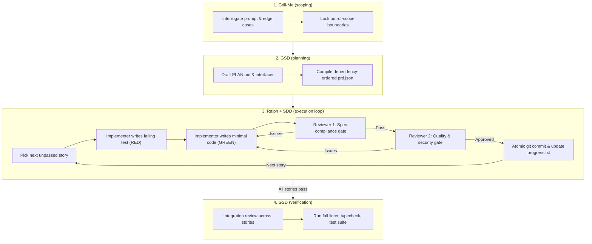

# Super-loop

Autonomous feature development pipelines for coding agents. Combines adversarial scoping (Grill-Me), system decomposition (GSD Core), headless execution loops (Ralph), and subagent review gates (SDD).

---

## Why this exists

If you have tried letting an LLM code autonomously for more than ten minutes, you know how it usually fails:
1. **Self-grading bias:** The agent writes buggy code, runs tests, sees failures, and either tweaks the tests to make them pass or marks the task complete anyway.
2. **Context exhaustion:** Tool calls, compiler output, and chat history pile up until the model runs out of attention and forgets earlier constraints.
3. **Scope drift:** Without clear boundary lines upfront, the agent starts refactoring unrelated files and pulling in unnecessary dependencies.

Super-Loop solves these problems by splitting the work into distinct roles and enforcing clean boundaries between them:
- **Grill-Me** attacks requirements and edge cases before a line of code is written.
- **GSD Core** structures the architecture, file boundaries, and acceptance criteria in `.planning/`.
- **Ralph** executes each story from `prd.json` in a fresh subprocess context.
- **Subagent-Driven Development (SDD)** enforces test-driven development (TDD) and requires two independent reviewers (spec compliance, then code quality) before any code is committed.

---

## Flavors: standard vs advanced

| Feature | `super-loop` | `super-loop-advanced` |
|---|---|---|
| Scoping | Grill-Me adversarial review | Grill-Me adversarial review |
| Planning | GSD architecture and `PLAN.md` | GSD architecture and `PLAN.md` |
| Execution | Ralph headless loop (`prd.json`) | Ralph headless loop (`prd.json`) |
| Context isolation | Fresh process per story | Fresh process per story |
| TDD enforcement | Optional | Strict Red-Green-Refactor |
| Review gates | Self-checked acceptance criteria | Two-stage independent review subagents |
| Cross-story check | Git log inspection | Integration reviewer subagent |
| Best suited for | Quick features and prototypes | Production code, libraries, and core modules |

---

## Architecture



---

## Installation

### Quick install

Clone the repository and run the installer:

```bash
git clone https://github.com/usamabaig0/super-loop.git
cd super-loop
./install.sh
```

The script will:
1. Link `super-loop` and `super-loop-advanced` into `~/.local/bin/`.
2. Install the skills into your agent environment (`~/.gemini/config/skills/`, or other supported agent config directories).

### Manual install

#### 1. CLI tools

```bash
mkdir -p ~/.local/bin
cp bin/super-loop ~/.local/bin/
cp bin/super-loop-advanced ~/.local/bin/
chmod +x ~/.local/bin/super-loop ~/.local/bin/super-loop-advanced
```

Make sure `~/.local/bin` is in your `$PATH`.

#### 2. Agent skills

Copy the skill directories into your agent skills path:

```bash
# For Antigravity / Gemini CLI:
mkdir -p ~/.gemini/config/skills
cp -r skills/super-loop ~/.gemini/config/skills/
cp -r skills/super-loop-advanced ~/.gemini/config/skills/

# For Claude Code / OpenCode / Hermes:
# Place inside your respective skills directory
```

---

## Usage

### In agent chat

You can invoke either skill directly inside your agent chat:

```text
/super-loop Add OAuth2 Google and GitHub login endpoints
```

or for the full SDD review pipeline:

```text
/super-loop-advanced Build a token bucket rate limiter with Redis backend
```

### From your terminal

Both tools work as standalone command-line runners:

#### 1. Initialize and plan a feature

```bash
super-loop-advanced "Add Redis rate limiter with token bucket algorithm"
```

This generates `scripts/ralph/prd.json` and prepares the task decomposition.

#### 2. Inspect status

```bash
super-loop-advanced --status
```

Output:
```text
=======================================================================
  Super-Loop Advanced Status (Grill-Me + GSD + Ralph + SDD)
  Project: Add Redis rate limiter
  Branch:  ralph/add-redis-rate-limiter | Completed: 1 / 3 stories
=======================================================================

  [✓] US-001: Foundational rate limiter interfaces (passed)
  [ ] US-002: Token bucket logic with sliding window (pending)
  [ ] US-003: Redis connection retry and edge cases (pending)
```

#### 3. Run the autonomous execution loop

```bash
super-loop-advanced --run 15
```

This runs up to 15 iterations. Each iteration picks the next incomplete story, dispatches a fresh implementer agent, enforces TDD, audits the code through both reviewer gates, and commits on approval.

#### 4. Run verification gates

```bash
super-loop-advanced --verify
```

Runs the project linter, typecheck, and test runner to confirm the working tree is green.

---

## CLI options

| Flag | Description | Default |
|---|---|---|
| `<feature description>` | Initialize pipeline and generate `prd.json` | - |
| `--run [N]` | Run headless execution loop for up to `N` iterations | 15 |
| `--status` | Display progress, stories, and review statuses | - |
| `--verify` | Run project build, typecheck, and tests | - |
| `--tool <name>` | CLI runner to invoke (`agy`, `claude`, `codex`, `amp`) | auto-detect |
| `-v, --version` | Display version | - |
| `-h, --help` | Display help | - |

---

## Core rules

1. **Implementers never self-grade:** The agent writing the code cannot mark a story as passed. Only the spec compliance reviewer has that authority.
2. **Spec compliance comes before code quality:** If an implementation does not meet the acceptance criteria in `prd.json`, reviewing code style is a waste of time. Spec issues trigger immediate fixes.
3. **Fresh context per story:** Every story and review runs in a new agent session. This keeps prompt tokens small and prevents early mistakes from polluting later work.
4. **Green commits only:** Every commit pushed to the feature branch must build cleanly and pass its tests.

---

## License

MIT License. See [LICENSE](LICENSE) for details.
