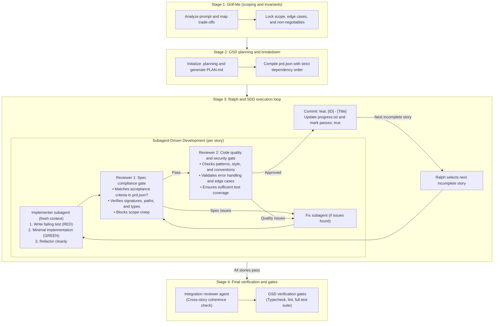

# Super-loop advanced: Grill-Me + GSD + Ralph + SDD

Autonomous coding loops often break down in predictable ways: agents mark their own incomplete code as passing, context windows get cluttered after multiple tool calls, and tests get skipped or quietly rewritten to match buggy output.

Super-Loop Advanced addresses these failure modes by combining four workflows:
1. Grill-Me: challenges assumptions, defines boundaries, and locks decisions before writing code.
2. GSD Core: defines file contracts, architecture, and acceptance criteria in `.planning/`.
3. Ralph: orchestrates headless story execution using `prd.json`, `progress.txt`, and isolated git branches.
4. Subagent-Driven Development (SDD): enforces test-driven development (TDD) and routes every story through two independent reviewer gates (spec compliance and code quality) before anything commits.

---

## When to use this

Use `/super-loop-advanced [feature description]` or the CLI command when:
- You want an autonomous pipeline from concept to verified production code.
- You need high test coverage and strict spec adherence without self-grading bias.
- You want clean, isolated subagent contexts that do not degrade over long runs.

---

## Architecture overview



---

## Pipeline details

### Stage 1: Grill-Me (adversarial scoping)
1. Requirement breakdown:
   - Finds hidden assumptions, schema constraints, and performance bottlenecks.
   - Defines what remains out of scope to avoid drift.
2. Design decisions:
   - Outlines key trade-offs with recommended defaults.
   - In autonomous mode, locks defaults and writes decisions into project tracking.

### Stage 2: GSD planning and specification
1. Project layout:
   - Sets up `.planning/` and `scripts/ralph/`.
2. Architecture specification:
   - Generates `.planning/phases/XX-[feature]/PLAN.md` with interfaces, types, and acceptance rules.
3. User story generation:
   - Breaks work into self-contained stories designed for single context windows.
   - Orders stories strictly: types and schemas first, core logic next, integration and UI last.
   - Writes concrete criteria for each story in `prd.json`.

### Stage 3: Ralph and subagent execution loop
Ralph runs through `prd.json`. For each story where `passes` is `false`:

#### Step 3.1: Implementer subagent (strict TDD)
Runs in an isolated session with only the current story requirements and recent notes from `progress.txt`:
1. Writes automated tests that fail against current code (Red).
2. Runs the test command to verify failure.
3. Writes minimal code to make tests pass (Green).
4. Refactors code without changing test behavior.

#### Step 3.2: Spec compliance reviewer gate
Audits the git diff against the story acceptance criteria:
- Are all listed requirements met?
- Do file paths, exported names, and function signatures match the spec?
- Did the implementer add unwanted changes or wander off scope?

If issues arise, a fix subagent applies corrections and re-tests.

#### Step 3.3: Code quality and security reviewer gate
Runs only after spec compliance passes:
- Does the code follow repository style and patterns?
- Are errors and edge cases handled safely?
- Are there security oversights or hardcoded secrets?
- Are tests comprehensive rather than shallow mocks?

If changes are requested, the fix subagent corrects them.

#### Step 3.4: Commit and log progress
Once both reviewer gates pass:
- Creates an atomic commit: `feat: [Story ID] - [Story Title]`.
- Sets `"passes": true` in `prd.json`.
- Appends implementation notes and lessons to `progress.txt`.

#### Step 3.5: Integration review
When all stories in `prd.json` pass, an integration agent checks that all pieces work together cleanly and no regressions were introduced across stories.

### Stage 4: Verification gate
1. Runs project verification tools:
   - Typechecker (`tsc`, `mypy`).
   - Linter (`eslint`, `ruff`).
   - Complete test suite (`pytest`, `vitest`, `npm test`).
2. Summarizes completed work and confirms the feature branch is ready for PR merge.

---

## Command line usage

```bash
# 1. Initialize and plan a feature
super-loop-advanced "Add real-time SSE notification stream with replay buffer"

# 2. View current status, stories, and review states
super-loop-advanced --status

# 3. Run the autonomous Ralph + SDD loop (default: 15 iterations)
super-loop-advanced --run 15

# 4. Run verification gates on working code
super-loop-advanced --verify
```

### Options:
- `--tool <agy|claude|codex|amp>`: Select AI CLI runner (default: auto-detected `agy`).
- `--iterations <N>`: Maximum iterations for the execution loop (default: 15).
- `--status`: Display user stories, pass status, and latest progress logs.
- `--verify`: Run project build, typecheck, and full test suite.

---

## Working rules

1. No self-grading: The implementer never marks its own story as passed. Only the spec compliance reviewer can approve criteria completion.
2. Spec before quality: Spec compliance must pass before code quality review starts. Clean code that solves the wrong problem gets rejected.
3. Fresh context: Implementers and reviewers run in clean subagent sessions to prevent token bloat and context fatigue.
4. Clean commits: Every commit on the branch must build and pass its test suite.
